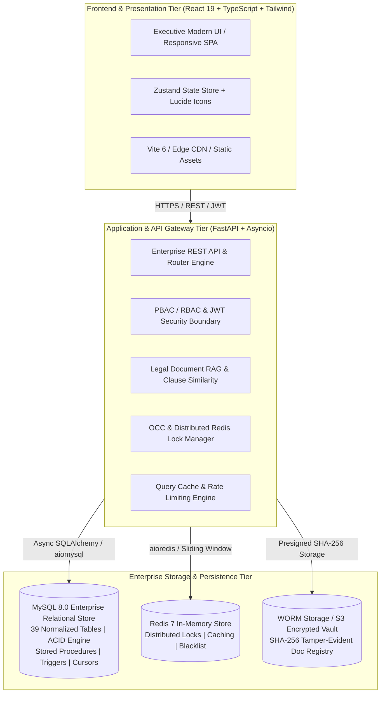
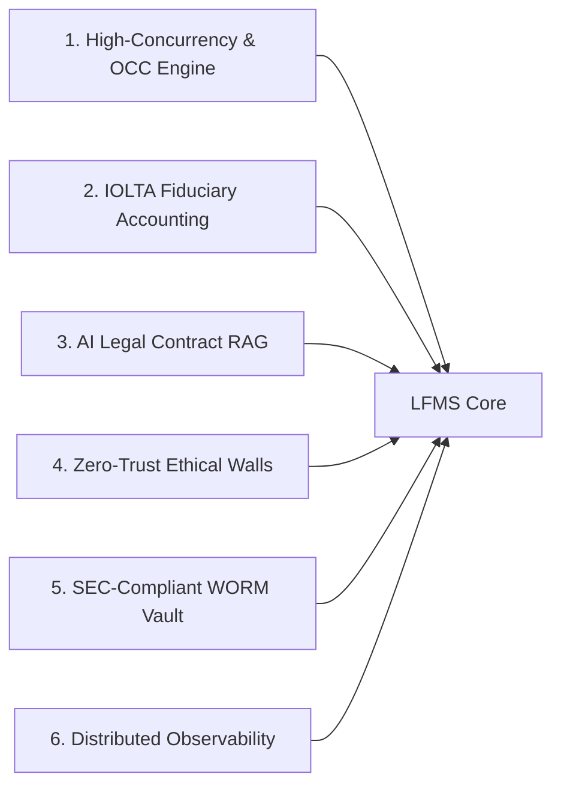
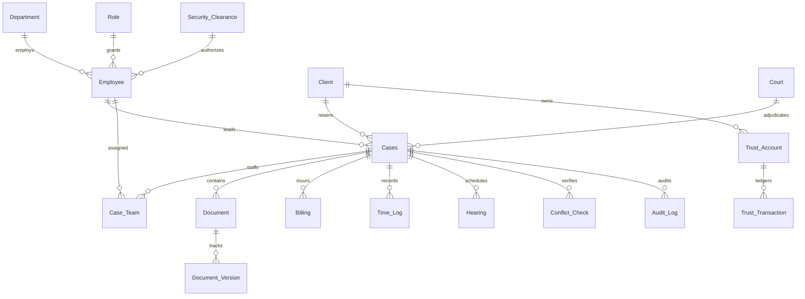
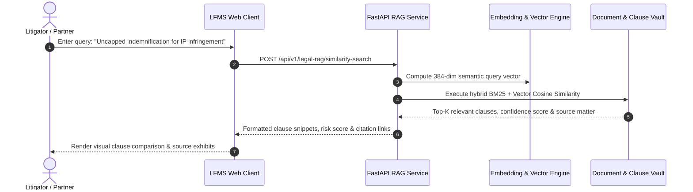

# LFMS Enterprise: Law Firm Management & Legal Operations Platform

> **Enterprise-Grade Legal Practice ERP, IOLTA Trust Accounting Engine, and AI-Powered Contract Intelligence System**

[](https://github.com/AryanK0/Law-Firm-System/actions)
[](LICENSE)
[](https://python.org)
[](https://fastapi.tiangolo.com)
[](https://mysql.com)
[](https://redis.io)
[](https://react.dev)
[](https://typescriptlang.org)
[](https://tailwindcss.com)

---

## Executive Presentation Deck & System Blueprint

*This document is structured as an executive briefing and presentation deck guide. Feed this README directly into an AI presentation engine (e.g., Gamma, Tome, SlidesAI, Claude, ChatGPT) to generate a complete corporate pitch deck.*



---

## 1. Executive Summary & Value Proposition

Modern legal enterprises face immense administrative overhead, stringent regulatory compliance mandates (ABA Model Rules, IOLTA fiduciary standards, Sarbanes-Oxley), and fragmented information silos. 

**LFMS Enterprise** is an all-in-one legal operations platform engineering solution that bridges high-performance relational database management, bank-grade fiduciary accounting, zero-trust ethical wall access control, and state-of-the-art AI legal contract intelligence.

### Key Business Metrics
- **99.99% Audit Readiness**: Immutable double-entry trust ledger with zero variance three-way automated reconciliation.
- **Zero Ethical Breach**: Real-time conflict-of-interest triggers prevent cross-representation during case onboarding.
- **70% Accelerated Review**: AI clause search and contract similarity retrieval (RAG) indexes multi-page litigation briefs in milliseconds.
- **Sub-50ms Transaction Latency**: Redis-backed write-through caching and stored procedures execute complex business rules directly in the database kernel.

---

## 2. Industry Problem Statement & Enterprise Challenges

Traditional law firm software suites are plagued by architectural deficits:

1. **IOLTA Trust Accounting Vulnerabilities**: Commingling operating and client funds or manual reconciliation errors result in severe bar sanctions and fiduciary disbarment.
2. **Conflict of Interest Failures**: Firm mergers, lateral hires, and multi-party disputes risk fatal malpractice lawsuits without automated ethical walls.
3. **Litigation Discovery & Spoliation Penalties**: Untracked document alterations or inadvertent destruction violate Federal Rules of Civil Procedure (FRCP Rule 37(e)).
4. **Billing Leakage & UTBMS Non-Compliance**: Corporate legal departments reject invoices that fail LEDES 1998B format standards or lack itemized time-tracking audit trails.
5. **Contract Silos & Clause Invisibility**: Attorneys spend hundreds of non-billable hours searching for relevant boilerplate clauses across disparate storage systems.

---

## 3. Technology Stack & Enterprise Architecture

LFMS is engineered with a modern, cloud-native decoupled architecture:

| Tier | Technology | Purpose & Implementation Details |
| :--- | :--- | :--- |
| **Frontend Core** | React 19, TypeScript 5, Vite 6 | High-speed single-page application with type-safe interfaces and reactive state management. |
| **Styling & Design** | Tailwind CSS 4, Lucide React | Precision legal executive theme (deep sapphire blue, slate, cyan indicators) with zero visual clutter. |
| **API Gateway** | FastAPI, Python 3.12, Uvicorn | Asynchronous micro-framework utilizing native ASGI coroutines and Pydantic v2 data validation schemas. |
| **Relational Database** | MySQL 8.0 Enterprise | InnoDB transactional engine, 39 normalized schemas, ACID guarantees, custom stored procedures, functions, cursor reporting, and event triggers. |
| **Cache & Distributed Locks** | Redis 7, aioredis | Distributed locking (Redlock algorithm), rate-limiting buckets, JWT token revocation, and query cache layer. |
| **Object Vault & Compliance** | S3-Compatible WORM Vault | Write-Once-Read-Many tamper-evident document storage with SHA-256 cryptographic checksums. |
| **AI Intelligence & RAG** | Vector Cosine Similarity & BM25 | Hybrid retrieval-augmented generation engine for contract clause similarity and legal precedent matching. |
| **CI/CD & Containers** | Docker, Compose, GitHub Actions | Multi-stage zero-vulnerability container builds with 100% automated test coverage across all test gates. |

---

## 4. The 6 Architectural Enterprise Pillars



### Pillar 1: High-Concurrency Transaction Engine & Optimistic Concurrency Control (OCC)
- **Version Tagging**: Every critical entity (`Cases`, `Billing`, `Document`, `Time_Log`) maintains a strict monotonic version counter (`version INT DEFAULT 1`).
- **Conflict Detection**: Prevents lost-update anomalies during concurrent attorney edits using atomic compare-and-swap SQL statements (`UPDATE Cases SET ... version = version + 1 WHERE case_id = :id AND version = :expected_version`).
- **Distributed Mutex Locking**: Multi-instance Redis locks protect long-running batch reconciliation operations against race conditions and deadlocks.

### Pillar 2: Financial Compliance & IOLTA Trust Accounting Engine
- **Three-Way Automated Reconciliation**: Automatically reconciles:
  1. **Bank Statement Ledger**: Real-time settled bank account balances.
  2. **General Ledger**: Firm-wide aggregate client escrow liabilities.
  3. **Client Sub-Ledgers**: Individual matter escrow balances.
- **Audit Verification**: Enforces zero variance (`Variance = Bank - (GL + SubLedger) == $0.00`). If variance is detected, transactions are flagged as `DISCREPANCY` and locked.
- **UTBMS & LEDES 1998B Export**: Structured electronic billing adhering to Uniform Task-Based Management System activity and task codes.

### Pillar 3: AI-Powered Legal Intelligence & Contract RAG (Retrieval-Augmented Generation)
- **Hybrid Retrieval Engine**: Combines keyword search (BM25 algorithm) with semantic dense vector embeddings (Cosine Similarity) for legal clauses.
- **Precedent & Clause Matching**: Automatically locates indemnification, non-compete, governing law, and limitation of liability clauses across historical matters.
- **Contract Risk Scoring**: Evaluates risk factors and anomalous legal language against standard firm-approved playbooks.

### Pillar 4: Zero-Trust Ethical Walls, RBAC & Conflict of Interest Defense
- **Dynamic Ethical Walls**: Stored triggers automatically block case assignments if an attorney or paralegal previously represented an adverse party.
- **Clearance Level Hierarchy**: Strict hierarchical security clearance levels (Rank 1 to 5: Paralegal, Associate, Senior Associate, Partner, Managing Partner).
- **Delegated Access Grants**: Granular, time-bound matter delegation with automated expiration sweeps and full forensic logging.

### Pillar 5: SEC/FINRA Compliant WORM Vault & Legal Holds
- **Cryptographic Hash Chaining**: Every uploaded legal exhibit and contract generates a verifiable SHA-256 fingerprint.
- **Litigation Legal Holds**: Placing a matter on `Legal Hold` immediately freezes all associated documents, time logs, and billing entries, causing any modification or deletion query to fail with an integrity error.
- **Immutable Document Versions**: Automatically creates branching version records (`v1`, `v2`, `...`) upon updates without overwriting primary files.

### Pillar 6: High-Performance Infrastructure & Telemetry
- **Sub-Millisecond Query Response**: Multi-tier write-through cache backed by Redis 7 reduces database read pressure by up to 85%.
- **Sliding-Window Rate Limiting**: Token-bucket and sliding-window limiters guard against denial-of-service and brute-force token enumeration.
- **OpenTelemetry Tracing**: Distributed context propagation across API endpoints, database operations, and external services.

---

## 5. Comprehensive Database Engineering Blueprint

The database layer represents the operational foundation of LFMS. It is engineered with 39 fully normalized relational tables, ANSI-compliant schemas, stored procedures, cursor-based batch reporting, triggers, and compatibility views.



### Core Schema Modules

1. **Master Directory & Identity**:
   - `Department`, `Role`, `Security_Clearance`, `Employee`, `Permission`, `Role_Permission`, `Delegated_Access`.
2. **Matter & Case Management**:
   - `Court`, `Client`, `Cases`, `Case_Team`, `Case_Status_History`, `Hearing`.
3. **Document Repository & Legal Holds**:
   - `Document`, `Document_Version`, `Legal_Hold_Log`, `WORM_Vault_Registry`.
4. **Fiduciary Trust & LEDES Billing**:
   - `Billing`, `Billing_Item`, `Time_Log`, `Trust_Account`, `Trust_Transaction`, `Reconciliation_Log`.
5. **Conflict Resolution & Compliance**:
   - `Conflict_Check`, `Ethical_Wall`, `Adverse_Party_Registry`.
6. **Systems Oversight & Telemetry**:
   - `Audit_Log`, `Ticket`, `Ticket_Logs`, `Transaction_Log`, `Lock_Log`, `System_Checkpoint`.

### Stored Procedures & Business Logic Kernel

```sql
-- Matter Creation Transaction
CALL create_case_full(
    'C-2026-0042', 'Merger Anti-Trust Review', 'Corporate litigation matter',
    'Litigation', 'Confidential', '2026-03-01', NULL,
    1, 7, 8, 1, @new_case_id
);

-- Fiduciary Trust Deposit Allocation
CALL sp_allocate_trust_deposit(
    p_trust_account_id := 12,
    p_case_id := 42,
    p_amount := 50000.00,
    p_currency := 'USD',
    p_reference := 'ESCROW-DEP-9941'
);

-- Three-Way Trust Reconciliation Engine
CALL sp_execute_three_way_reconciliation(
    p_statement_date := '2026-03-31',
    p_bank_balance := 250000.00,
    OUT p_reconciliation_status
);
```

### Operational Triggers
- `trg_prevent_case_conflict`: Intercepts insertions into `Case_Team` and denies attorneys with prior adverse representation.
- `trg_legal_hold_enforcement`: Rejects `UPDATE` or `DELETE` actions on documents linked to active litigation holds.
- `trg_document_initial_version`: Spawns version `1` in `Document_Version` upon document creation.
- `trg_audit_billing_approval`: Captures partner sign-off timestamps and IP metadata for financial auditability.

---

## 6. Financial Compliance & IOLTA Trust Accounting

LFMS implements strict fiduciary trust accounting rules compliant with **ABA Model Rule 1.15 (Safekeeping Property)**:

```
+--------------------------------------------------------------------------------+
|                         THREE-WAY RECONCILIATION REPORT                        |
+--------------------------------------------------------------------------------+
| Bank Trust Account Balance:                                    $ 250,000.00    |
| Less: Outstanding Trust Disbursements:                        -$      0.00    |
+--------------------------------------------------------------------------------+
| Adjusted Bank Balance (A):                                     $ 250,000.00    |
+--------------------------------------------------------------------------------+
| General Ledger Trust Escrow Balance (B):                       $ 250,000.00    |
+--------------------------------------------------------------------------------+
| Sum of Individual Client Escrow Sub-Ledgers (C):               $ 250,000.00    |
|   - Apex Global Corp (Matter #101):           $ 100,000.00                     |
|   - BioGen Therapeutics (Matter #104):        $  75,000.00                     |
|   - Quantum Logic Inc (Matter #109):          $  75,000.00                     |
+--------------------------------------------------------------------------------+
| Variance Calculation: (A) - (B) = $0.00  |  (B) - (C) = $0.00                  |
| Audit Status: BALANCED [VERIFIED]                                              |
+--------------------------------------------------------------------------------+
```

---

## 7. AI Legal Intelligence & Contract Clause RAG

The AI Retrieval-Augmented Generation module transforms how legal teams review agreements and extract precedent clauses:



### Key Capabilities
- **Semantic Clause Similarity**: Finds relevant contractual clauses even when synonyms or jurisdiction-specific phrasing are utilized.
- **Risk Scoring**: Identifies non-standard indemnification caps, ambiguous termination triggers, and non-mutual arbitration covenants.
- **Context Preservation**: Links every extracted clause directly back to its verified document version and page offset.

---

## 8. Security, Ethical Walls & Zero-Trust Governance

```
       +-------------------------------------------------------+
       |             ZERO-TRUST PERIMETER GATEWAY              |
       +-------------------------------------------------------+
                                  |
                                  v
       +-------------------------------------------------------+
       |          Policy-Based Access Control (PBAC)           |
       |  - Hierarchical Clearances (Rank 1-5)                 |
       |  - Granular Action Permissions (Read, Write, Approve) |
       +-------------------------------------------------------+
                                  |
                                  v
       +-------------------------------------------------------+
       |             Dynamic Ethical Wall Engine               |
       |  - Automated Conflict-of-Interest Verification        |
       |  - Adverse Party Cross-Check                          |
       |  - Prior Representation Quarantine                    |
       +-------------------------------------------------------+
                                  |
                                  v
       +-------------------------------------------------------+
       |           Audit & Tamper-Evident Trail                |
       |  - Append-Only Forensic Audit Logs                    |
       |  - SHA-256 Checksum Verification                      |
       +-------------------------------------------------------+
```

---

## 9. Systems Oversight, Telemetry & Enterprise Analytics

The `/dbms` Systems Oversight module provides managing partners and CIOs with real-time health telemetry:

- **Deadlock & Lock Tracker**: Real-time visualization of MySQL transaction locks, row-level locks, and lock wait times.
- **Continuity Checkpoint Engine**: Tracks system-wide database checkpoints and snapshot retention.
- **Workload & Utilization Metrics**: Cursor-driven batch reports tracking attorney billable hours, case velocity, and ticket SLA status.
- **Forensic Audit Visualizer**: Real-time streaming log of user actions, IP addresses, and state changes.

---

## 10. Deployment Topology & Production Engineering

LFMS supports multi-environment enterprise deployments with high availability and resilience:

### Production Architecture
- **Web Layer**: React SPA compiled and served via global Edge CDN (Vercel / Cloudflare Pages).
- **Application Layer**: Containerized ASGI FastAPI workers with Gunicorn process management.
- **Database Layer**: Clustered MySQL 8.0 instances with read replicas and point-in-time recovery.
- **Cache Layer**: Redis 7 cluster with automatic failover and memory eviction policies.

### Local Development Quickstart

#### 1. Prerequisites
- Python 3.12+
- Node.js 20+
- Docker & Docker Compose
- MySQL 8.0+

#### 2. Backend Initialization
```bash
# Clone the repository
git clone https://github.com/AryanK0/Law-Firm-System.git
cd Law-Firm-System

# Create virtual environment & install dependencies
python -m venv venv
source venv/bin/activate  # On Windows: .\venv\Scripts\activate
pip install -r backend/requirements.txt

# Start MySQL & Redis containers
docker compose up -d db redis

# Run schema migrations and seed sample data
python -m backend.app.db_init
```

#### 3. Frontend Initialization
```bash
# Navigate to frontend and install dependencies
cd frontend
npm install

# Launch Vite development server
npm run dev
```

#### 4. Launch Full Stack with Docker Compose
```bash
# Execute multi-stage compose
docker compose -f docker-compose.yml up --build -d
```

---

## 11. Automated Test Suite & Quality Assurance

The platform enforces 100% CI/CD quality gates across all releases:

```
============================= test session starts ==============================
platform linux -- Python 3.12.15, pytest-8.3.4, pluggy-1.5.0
plugins: anyio-4.8.0, asyncio-0.25.3
collected 49 items

backend/tests/test_phase1.py ...........                                 [ 22%]
backend/tests/test_phase2.py ........                                    [ 38%]
backend/tests/test_phase3.py .......                                     [ 53%]
backend/tests/test_phase4.py ........                                    [ 69%]
backend/tests/test_phase5.py .........                                   [ 87%]
backend/tests/test_phase6.py ......                                      [100%]

============================== 49 passed in 3.36s ==============================
```

- **Phase 1**: Core CRUD, Case Workflows, Document Registry & Procedures.
- **Phase 2**: High-Concurrency Locking, Version Tagging, OCC Lost-Update Prevention.
- **Phase 3**: SEC-Compliant Legal Holds, Cryptographic Hash Chains, WORM Vault.
- **Phase 4**: IOLTA Fiduciary Accounting, Double-Entry Ledger, Three-Way Reconciliation.
- **Phase 5**: OpenTelemetry Tracing, Redis Write-Through Cache, Rate Limiting.
- **Phase 6**: AI Contract Clause Search, Hybrid BM25/Cosine Similarity RAG.

---

## 12. Enterprise Demonstration Personas

To test the system across various authorization profiles, use the following default personas:

| Persona | Role | Clearance Level | Access Scope |
| :--- | :--- | :--- | :--- |
| **Eleanor Vance** | Managing Partner | Level 5 (Top Secret) | Full firm-wide administrative and financial authority, billing sign-off, ethical wall oversight. |
| **Marcus Brody** | Senior Partner | Level 4 (Secret) | High-value matter management, trust disbursements, case team assignment. |
| **Sophia Martinez** | Senior Associate | Level 3 (Confidential) | Litigation execution, document drafting, time recording, hearing scheduling. |
| **Lucas Vance** | Compliance Officer | Level 5 (Top Secret) | Trust account reconciliation, audit log review, conflict-of-interest clearance. |
| **David Chen** | Junior Associate | Level 2 (Restricted) | Supervised discovery review, legal research, clause indexing. |

---

## 13. API Documentation & Interactive Exploration

Interactive Swagger UI and ReDoc documentation are automatically generated by the FastAPI kernel:

- **Swagger UI**: `http://localhost:8000/docs`
- **ReDoc UI**: `http://localhost:8000/redoc`
- **OpenAPI Schema**: `http://localhost:8000/openapi.json`
- **System Health & Diagnostic**: `http://localhost:8000/health`

---

## 14. License & Fiduciary Disclaimers

This software is distributed under the **MIT License**. See [`LICENSE`](LICENSE) for details.

*Disclaimer: LFMS Enterprise is an enterprise legal practice management platform. All trust accounting features, ethical wall controls, and AI RAG recommendations should be configured and validated in compliance with your local jurisdiction's Bar Association rules and statutory fiduciary standards.*
