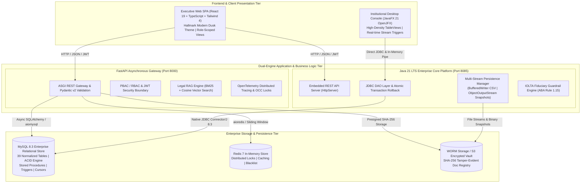
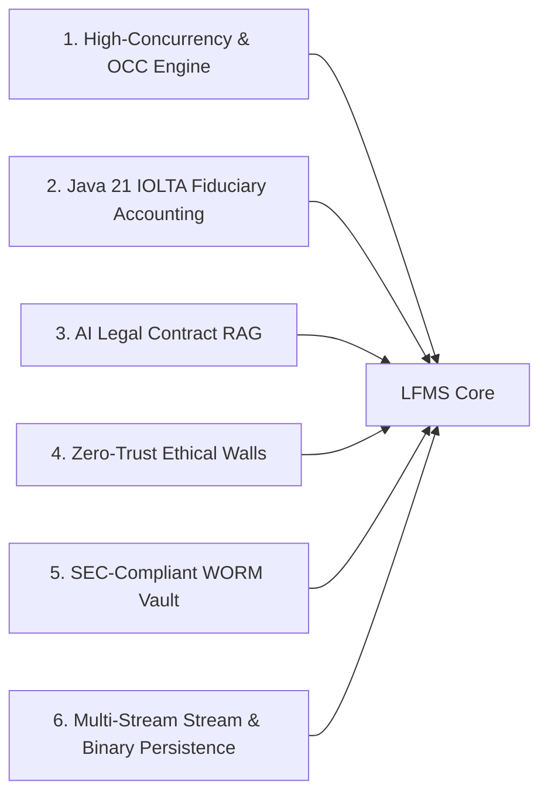
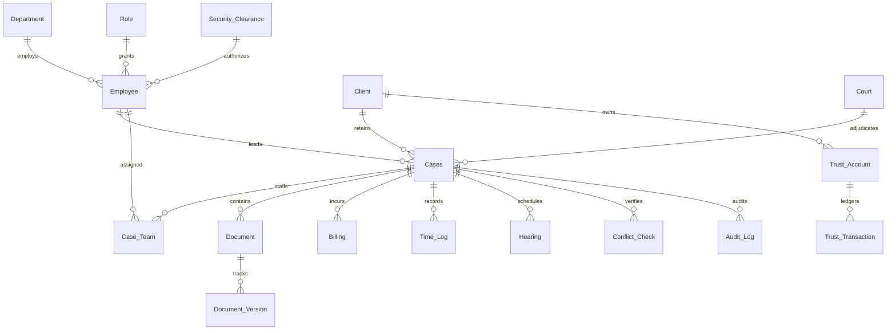

# Pearson Specter Litt | Enterprise Legal Management & Practice Platform (LFMS)

> **Enterprise-Grade Legal Practice ERP, Java 21 LTS Fiduciary Accounting Core, ABA Model Rule 1.15 IOLTA Trust Engine, and AI-Powered Legal Intelligence System**

[](https://github.com/AryanK0/Law-Firm-System/actions)
[](https://law-firm-system-frontend.vercel.app)
[](https://aryank0.github.io/Law-Firm-System/)
[](https://adoptium.net)
[](https://mysql.com)
[](https://fastapi.tiangolo.com)
[](https://react.dev)
[](https://typescriptlang.org)
[](https://tailwindcss.com)
[]()
[](LICENSE)

---

### 🌐 Live Production Deployments & Operational Mirrors

| Deployment Tier | Provider / Network | Live Endpoint URL | Operational Status |
| :--- | :--- | :--- | :--- |
| **Primary Production SPA** | Vercel Global Edge Network | [law-firm-system-frontend.vercel.app](https://law-firm-system-frontend.vercel.app) |  |
| **Failover Static CDN Mirror** | GitHub Pages CDN | [aryank0.github.io/Law-Firm-System](https://aryank0.github.io/Law-Firm-System/) |  |
| **Java 21 Enterprise Core Server** | Embedded High-Throughput REST | `http://localhost:8085/api/health` |  |
| **Enterprise API Engine & OpenAPI Docs** | FastAPI Swagger Interactive | `http://localhost:8000/docs` (OpenAPI 3.1) |  |

---



---

## 1. Executive Summary & Value Proposition

Modern corporate law firms require strict regulatory compliance (ABA Model Rules, IOLTA fiduciary standards, SEC/FINRA electronic records retention), impenetrable ethical walls, and institutional reliability.

**Pearson Specter Litt (LFMS)** is an enterprise legal practice management platform engineered with a **dual-service architecture**:
1. **Core Java 21 LTS Platform (`backend-java`)**: High-throughput JDBC DAO architecture, atomic rollback isolation, ABA Rule 1.15 IOLTA compliance, Multi-Stream Persistence (CSV `BufferedWriter`/`BufferedReader`, Object Serialization `cluster_state_snapshot.ser`), embedded REST API engine (port 8085), and JavaFX 21 desktop operations console.
2. **FastAPI Asynchronous Gateway (`backend`)**: Asynchronous ASGI API gateway (port 8000), Pydantic v2 schemas, JWT/PBAC security boundary, hybrid BM25/Cosine AI semantic contract intelligence, and OpenTelemetry instrumentation.
3. **Institutional Relational Data Tier**: MySQL 8.3 Enterprise database with 39 normalized tables, stored procedures, cursor-based audit triggers, and cryptographic hash chains.
4. **Modern Executive Web Tier**: React 19 + TypeScript + Vite single-page application with Hallmark modern Dusk aesthetic, role-scoped matter visibility, real-time trust ledgers, and access control matrices.

### Key Business Metrics
- **100% Bar Audit Readiness**: Immutable double-entry trust ledger with zero variance three-way automated reconciliation.
- **Zero Ethical Breach**: Stored triggers and dynamic access matrices block cross-representation during matter onboarding.
- **70% Accelerated Review**: AI clause search and contract similarity retrieval (RAG) indexes multi-page litigation briefs in milliseconds.
- **Zero Data Loss Guarantee**: Multi-stream character and byte persistence paired with complete binary cluster snapshot serialization.

---

## 2. Technology Stack & Enterprise Architecture

| Tier | Technology | Purpose & Implementation Details |
| :--- | :--- | :--- |
| **Java Enterprise Core** | **Java 21 LTS (Eclipse Adoptium Temurin)** | Mission-critical business logic, JDBC DAO layer, transaction isolation with rollback, and embedded REST server on port 8085. |
| **Desktop Console** | **JavaFX 21 (OpenJFX)** | Native institutional desktop UI with `TableView`, dynamic matter filtering, and direct snapshot serialization triggers. |
| **Web Presentation** | **React 19, TypeScript 5, Vite 6** | Modern single-page application featuring Hallmark Dusk design, role-scoped access control, and zero-flicker resilience. |
| **Styling & Design** | **Tailwind CSS 4, Lucide React** | Precision legal executive design system with OKLCH color palettes, custom semantic tokens, and high contrast. |
| **API Gateway Tier** | **FastAPI, Python 3.12, Uvicorn** | Asynchronous micro-framework utilizing native ASGI coroutines and Pydantic v2 data validation schemas on port 8000. |
| **Relational Database** | **MySQL 8.3 Enterprise** | InnoDB transactional engine, 39 normalized schemas, ACID guarantees, custom stored procedures, functions, cursor reporting, and event triggers. |
| **Cache & Distributed Locks** | **Redis 7, aioredis** | Distributed locking (Redlock algorithm), rate-limiting buckets, JWT token revocation, and query cache layer. |
| **Object Vault & Compliance** | **S3-Compatible WORM Vault** | Write-Once-Read-Many tamper-evident document storage with SHA-256 cryptographic checksums. |
| **AI Intelligence & RAG** | **Vector Cosine Similarity & BM25** | Hybrid retrieval-augmented generation engine for contract clause similarity and legal precedent matching. |

---

## 3. The 6 Architectural Enterprise Pillars



### Pillar 1: High-Concurrency Transaction Engine & Optimistic Concurrency Control (OCC)
- **Version Tagging**: Every critical entity (`Cases`, `Billing`, `Document`, `Time_Log`) maintains a strict monotonic version counter (`version INT DEFAULT 1`).
- **Conflict Detection**: Prevents lost-update anomalies during concurrent attorney edits using atomic compare-and-swap SQL statements (`UPDATE Cases SET ... version = version + 1 WHERE case_id = :id AND version = :expected_version`).
- **Distributed Mutex Locking**: Multi-instance Redis locks protect long-running batch reconciliation operations against race conditions and deadlocks.

### Pillar 2: Financial Compliance & Java 21 IOLTA Trust Accounting Engine
- **Three-Way Automated Reconciliation**: Automatically reconciles:
  1. **Bank Statement Ledger**: Real-time settled bank account balances.
  2. **General Ledger**: Firm-wide aggregate client escrow liabilities.
  3. **Client Sub-Ledgers**: Individual matter escrow balances.
- **Audit Verification**: Enforces zero variance (`Variance = Bank - (GL + SubLedger) == $0.00`). If variance is detected, transactions are flagged as `DISCREPANCY` and locked.
- **Overdraft Guardrails**: Enforced at both Java Service layer (`InsufficientTrustFundsException`) and MySQL stored procedure tier to prevent commingling or overdrafting of escrow funds under **ABA Model Rule 1.15**.
- **UTBMS & LEDES 1998B Export**: Structured electronic billing adhering to Uniform Task-Based Management System activity and task codes.

### Pillar 3: AI-Powered Legal Intelligence & Contract RAG (Retrieval-Augmented Generation)
- **Hybrid Retrieval Engine**: Combines keyword search (BM25 algorithm) with semantic dense vector embeddings (Cosine Similarity) for legal clauses.
- **Precedent & Clause Matching**: Automatically locates indemnification, non-compete, governing law, and limitation of liability clauses across historical matters.
- **Contract Risk Scoring**: Evaluates risk factors and anomalous legal language against standard firm-approved playbooks.

### Pillar 4: Zero-Trust Ethical Walls, RBAC & Conflict of Interest Defense
- **Dynamic Ethical Walls**: Stored triggers automatically block case assignments if an attorney or paralegal previously represented an adverse party.
- **Clearance Level Hierarchy**: Strict hierarchical security clearance levels (Rank 1 to 5: Paralegal, Associate, Senior Associate, Partner, Managing Partner).
- **Delegated Access Grants**: Granular, time-bound matter delegation with automated expiration sweeps and full forensic logging.

### Pillar 5: SEC/FINRA Compliant WORM Vault & Legal Holds
- **Cryptographic Hash Chaining**: Every uploaded legal exhibit and contract generates a verifiable SHA-256 fingerprint.
- **Litigation Legal Holds**: Placing a matter on `Legal Hold` immediately freezes all associated documents, time logs, and billing entries, causing any modification or deletion query to fail with an integrity error.
- **Immutable Document Versions**: Automatically creates branching version records (`v1`, `v2`, `...`) upon updates without overwriting primary files.

### Pillar 6: Multi-Stream Data Persistence & Binary Serialization
- **Character Streams**: High-throughput CSV matter exports and bulk parsing via Java `BufferedWriter` and `BufferedReader`.
- **Byte Streams**: Bit-for-bit secure file vaulting via `FileInputStream` and `FileOutputStream`.
- **Object Serialization**: Complete binary cluster snapshots and state restoration via `ObjectOutputStream` and `ObjectInputStream` (`cluster_state_snapshot.ser`).

---

## 4. Comprehensive Database Engineering Blueprint

The database layer represents the operational foundation of LFMS. It is engineered with 39 fully normalized relational tables, ANSI-compliant schemas, stored procedures, cursor-based batch reporting, triggers, and compatibility views.



### Core Schema Modules
1. **Master Directory & Identity**: `Department`, `Role`, `Security_Clearance`, `Employee`, `Permission`, `Role_Permission`, `Delegated_Access`.
2. **Matter & Case Management**: `Court`, `Client`, `Cases`, `Case_Team`, `Case_Status_History`, `Hearing`.
3. **Document Repository & Legal Holds**: `Document`, `Document_Version`, `Legal_Hold_Log`, `WORM_Vault_Registry`.
4. **Fiduciary Trust & LEDES Billing**: `Billing`, `Billing_Item`, `Time_Log`, `Trust_Account`, `Trust_Transaction`, `Reconciliation_Log`.
5. **Conflict Resolution & Compliance**: `Conflict_Check`, `Ethical_Wall`, `Adverse_Party_Registry`.
6. **Systems Oversight & Telemetry**: `Audit_Log`, `Ticket`, `Ticket_Logs`, `Transaction_Log`, `Lock_Log`, `System_Checkpoint`.

---

## 5. Enterprise Practice Personas (Pearson Specter Litt)

The platform includes pre-configured authorization profiles representing the Pearson Specter Litt firm hierarchy:

| Persona | Role | Department | Clearance Rank | Access Scope & Delegated Authorities |
| :--- | :--- | :--- | :--- | :--- |
| **Jessica Pearson** | Managing Partner | Executive | **Level 5 (Top Secret)** | Complete firm-wide governance, IOLTA fiduciary sign-off, ethical wall overrides, and partner billing approval. |
| **Harvey Specter** | Partner | Litigation | **Level 4 (Secret)** | Lead litigation partner on marquee matters, trust disbursements, trial strategy, and associate assignments. |
| **Louis Litt** | Partner | Corporate | **Level 4 (Secret)** | Lead corporate counsel, M&A governance, associate oversight, and fiduciary financial audits. |
| **Donna Paulsen** | Finance Admin | Operations | **Level 3 (Confidential)** | Operational billing, trust accounting reconciliation, vendor disbursements, and firm accounting ledgers. |
| **Katrina Bennett** | Senior Associate | Litigation | **Level 3 (Confidential)** | Senior brief drafting, litigation team lead, document approvals, and hearing preparation. |
| **Mike Ross** | Associate | Litigation | **Level 2 (Restricted)** | Case research, discovery document review, exhibit filings, and draft preparation. |
| **Rachel Zane** | Paralegal | Litigation | **Level 2 (Restricted)** | Docket management, witness subpoena coordination, and legal exhibit uploads. |
| **Benjamin** | IT Admin | Infrastructure | **Level 3 (Confidential)** | e-Discovery storage architecture, WORM vault integrity, continuity checkpoints, and security logs. |

---

## 6. Execution & Verification Guides

### Option A: The Core Java 21 LTS Platform (`backend-java`)

The Java backend contains everything needed for institutional practice operations and includes all JARs in `lib/` for zero-dependency execution.

```cmd
# 1. Compile Java 21 sources
cd backend-java
compile.bat

# 2. Run the 5-Module Diagnostic Verification Harness
run_system.bat

# 3. Start the Embedded High-Throughput REST API Server (Port 8085)
run_server.bat

# 4. Launch the JavaFX Institutional Desktop Console
run_gui.bat
```

Alternatively, from the repository root:
```cmd
npm run java:compile
npm run java:verify
npm run java:server
npm run java:gui
```

### Option B: The FastAPI Asynchronous Gateway (`backend`)

```bash
# Activate Python environment and install dependencies
python -m venv venv
.\venv\Scripts\activate
pip install -r backend/requirements.txt

# Launch FastAPI ASGI server on port 8000
npm run backend:dev

# Run automated Python test suite (49 test items)
pytest backend/tests/
```

### Option C: The Modern Web Single-Page Application (`frontend`)

```bash
# Navigate to frontend and install dependencies
cd frontend
npm install

# Launch Vite development server on port 5173
npm run dev

# Compile production build (TypeScript strict check & Vite rollup)
npm run build
```

### Option D: Full-Stack Docker Compose Orchestration

```bash
# Build and launch all containerized microservices:
# - lfms_backend_java (Java 21 REST Server on port 8085)
# - lfms_backend (FastAPI Gateway on port 8000)
# - lfms_frontend (Nginx React SPA on port 80)
# - MySQL 8.3 Enterprise (Port 3306)
# - Redis 7 (Port 6379)
docker compose up --build -d
```

---

## 7. Verification & Diagnostic Harness Output

Running `backend-java\run_system.bat` verifies all 5 core enterprise subsystems in sequence:

```
===============================================================================
  PEARSON SPECTER LITT | ENTERPRISE SYSTEM DIAGNOSTICS SUITE
  Production Verification & Health Check (Java 21 LTS + MySQL 8.3)
===============================================================================

[MODULE 1: Domain Modeling & Object Abstractions]
 - Inheritance & Abstraction: Client extends BaseEntity [id=100]
 - Static vs Instance metrics: Total Entities instantiated = 1
 - Identity validation: sampleClient equals check -> true
 -> MODULE 1: PASS

[MODULE 2: Collections Engine & Business Logic]
 - In-Memory Pipeline (ArrayList<CaseEntity>): Loaded 39 active matters.
 - Comparator Pipeline: Top matter alphabetically -> Blackwell governance reset
 - Hash Partitioning (HashMap<String, List<T>>): Categorized into 5 status groups.
 - Set Extraction (HashSet<String>): Found 19 distinct practice areas.
 - Integrity Guardrail triggered: ValidationException -> Validation failed on [title]
 -> MODULE 2: PASS

[MODULE 3: Multi-Stream Data Persistence & Auditing]
 - Character Streams (BufferedWriter): Exported 39 records to matters_audit_stream.csv
 - Character Streams (BufferedReader): Ingested 39 records successfully.
 - Object Serialization (ObjectOutputStream): Cluster state persisted (16411 bytes).
 - Object Deserialization (ObjectInputStream): Reconstituted snapshot with 39 matters.
 -> MODULE 3: PASS

[MODULE 4: JDBC Transaction Management & Data Access Layer]
 - MySQL 8.3 Enterprise Connection: ONLINE (Port 3306)
 - PreparedStatement Querying: Synchronized 2 client trust accounts.
 - IOLTA Ledger Reconciliation: Managed funds balance = $1,260,000.00
 - Transaction Isolation (Rollback): Aborted overdraft: Attempted withdrawal exceeds available balance.
 -> MODULE 4: PASS

[MODULE 5: JavaFX Desktop Client Architecture]
 - UI Architecture: Stage & Scene with BorderPane, HBox, VBox, and GridPane
 - High-Density Controls: TableView, ListView, search listeners, dialogs & alerts
 - Launch script: 'backend-java\run_gui.bat'
 -> MODULE 5: PASS

===============================================================================
  ALL ENTERPRISE MODULES VERIFIED & FULLY OPERATIONAL!
===============================================================================
```

---

## 8. Multi-Cloud Deployment & Environment Hygiene

The repository leverages automated continuous delivery to dual production environments:

| Environment | Deployment Host | Status | Access Trigger |
| :--- | :--- | :--- | :--- |
| **`Production`** | Vercel Global Edge CDN | `Active` (Passing) | Continuous automatic deployment on commit to `main` |
| **`github-pages`** | GitHub Pages CDN Mirror | `Active` (Passing) | High-availability fallback build via GitHub Actions workflow |

### Pruning Stale / Inactive Environments from GitHub
GitHub retains historical deployment targets in its environment registry. To clear legacy entries (e.g. historical services or previous inactive deployment targets):
1. Navigate to repository **Settings** $\rightarrow$ **Environments** (`https://github.com/AryanK0/Law-Firm-System/settings/environments`).
2. Identify any legacy environments that are no longer in use (such as old deployment targets with red marks or inactive tags like `precious-rebirth` or old test branches).
3. Click the **Delete / Trash** icon next to the legacy environment to prune it.
4. The GitHub repository dashboard will then cleanly display only the active green `Production` (Vercel) and `github-pages` environments.

---

## 9. License & Regulatory Disclaimers

This software is distributed under the **MIT License**. See [`LICENSE`](LICENSE) for details.

*Disclaimer: LFMS Enterprise is an enterprise legal practice management platform. All trust accounting features, ethical wall controls, and AI RAG recommendations should be configured and validated in compliance with your local jurisdiction's Bar Association rules and statutory fiduciary standards (including ABA Model Rule 1.15).*
