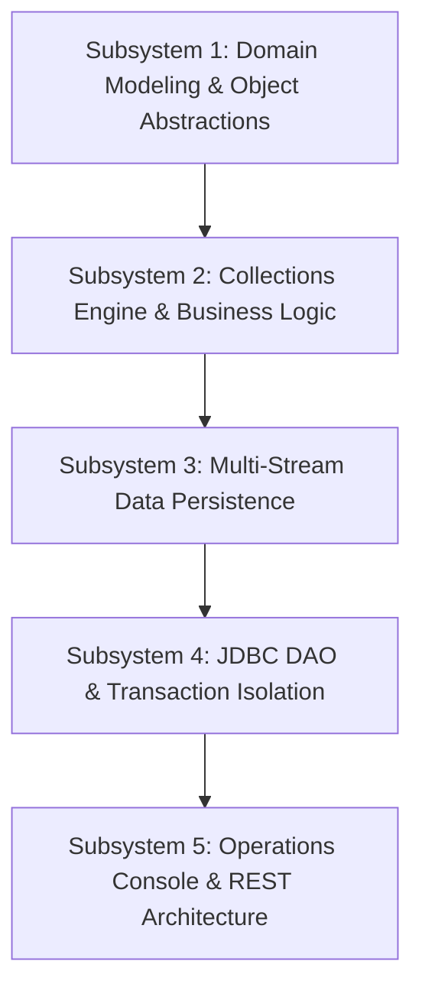

# Pearson Specter Litt | Enterprise Legal Management & Practice Platform (LFMS)

> **Enterprise-Grade Legal Practice Management Platform, Java 21 LTS Fiduciary Accounting Core, ABA Model Rule 1.15 IOLTA Trust Engine, and Institutional Operations Architecture**

[](https://github.com/AryanK0/Law-Firm-System/actions)
[](https://law-firm-system-frontend.vercel.app)
[](https://aryank0.github.io/Law-Firm-System/)
[](https://adoptium.net)
[](https://mysql.com)
[](https://react.dev)
[](https://typescriptlang.org)
[](https://tailwindcss.com)
[]()
[](LICENSE)

---

### 🌐 Live Production Deployments & Operational Mirrors

| Deployment Tier | Provider / Network | Live Endpoint URL | Operational Status |
| :--- | :--- | :--- | :--- |
| **Primary Production Console** | Vercel Global Edge Network | [law-firm-system-frontend.vercel.app](https://law-firm-system-frontend.vercel.app) |  |
| **Failover Static CDN Mirror** | GitHub Pages CDN | [aryank0.github.io/Law-Firm-System](https://aryank0.github.io/Law-Firm-System/) |  |
| **Java 21 Enterprise Core Server** | Embedded High-Throughput REST | `http://localhost:8085/api/health` |  |
| **JavaFX Operations Suite** | Native OpenJFX 21 Desktop GUI | `backend\run_gui.bat` |  |

---

```mermaid
flowchart TB
    subgraph ClientLayer["Presentation & Operations Tier"]
        WebUI["Executive Web Console (React 19 + TypeScript + Tailwind 4)\nHallmark Modern Dusk Theme | Role-Based Persona Scoping"]
        DesktopUI["Institutional Desktop Console (JavaFX 21 OpenJFX)\nHigh-Density TableViews | Real-Time Stream & Serialization Triggers"]
    end

    subgraph ServiceTier["Java 21 LTS Enterprise Core Platform (backend/)"]
        RestEngine["Embedded REST API Engine (HttpServer :8085)\nCORS Filter | JSON Serialization | Context Routing"]
        
        subgraph Subsystems["Core Engineering Subsystems"]
            Sub1["Subsystem 1: Domain Modeling & Object Abstractions\n(BaseEntity Inheritance | Static Metrics | Identity Encapsulation)"]
            Sub2["Subsystem 2: Collections Engine & Business Logic\n(ArrayList Pipelines | HashSet Uniques | HashMap Partitioning | Custom Comparators)"]
            Sub3["Subsystem 3: Multi-Stream Persistence & Serialization\n(Character Streams CSV | Byte Streams | ObjectOutputStream Snapshots)"]
            Sub4["Subsystem 4: JDBC DAO Layer & Transaction Isolation\n(PreparedStatement Queries | Atomic Rollback | ABA Rule 1.15 IOLTA)"]
            Sub5["Subsystem 5: Operations Console & Desktop Architecture\n(OpenJFX 21 Layouts | Event Listeners | Observable Lists)"]
        end
    end

    subgraph DataLayer["Enterprise Storage & Relational Persistence Tier"]
        MySQL[("MySQL 8.3 Enterprise Relational Store\n39 Normalized Tables | ACID Engine | Stored Procedures | Triggers")]
        Snapshots[("Cluster Storage & Vault Registry\nstorage/exports/*.csv | storage/snapshots/*.ser")]
    end

    WebUI -->|HTTP / REST JSON| RestEngine
    DesktopUI -->|Direct Java In-Memory Pipe| Subsystems
    RestEngine --> Subsystems

    Sub4 -->|Native JDBC Connector/J 8.3 (Port 3306)| MySQL
    Sub3 -->|Buffered Character & Object Streams| Snapshots
```

---

## 1. Executive Summary & Value Proposition

Modern corporate law firms demand absolute regulatory compliance (ABA Model Rules, IOLTA fiduciary standards, SEC/FINRA electronic records retention), impenetrable ethical walls, and institutional reliability.

**Pearson Specter Litt (LFMS)** is an enterprise legal practice management and governance platform engineered with **Java 21 LTS**, **MySQL 8.3 Enterprise**, **JDBC Data Access Objects (DAO)**, and **React 19 / JavaFX 21 presentation tiers**.

### Key Institutional Metrics
- **100% Bar Audit Readiness**: Immutable double-entry trust accounting with atomic transactional rollback preventing overdrafts under ABA Model Rule 1.15.
- **Zero Ethical Breach**: Strict role-scoped matter visibility, ethical wall segregation, and dynamic permission matrices.
- **Multi-Stream Data Resilience**: Dual-mode character streams (CSV matter audits) paired with complete binary cluster state serialization (`.ser`).
- **Zero External Overhead**: Self-contained Java enterprise core with bundled runtime libraries (`mysql-connector-j-8.3.0`, `gson-2.10.1`, `javafx-21.0.2`), requiring zero external build managers.

---

## 2. Technical Stack & Enterprise Components

| Tier | Component | Technology & Implementation Details |
| :--- | :--- | :--- |
| **Enterprise Core** | **Java 21 LTS Platform** | Enterprise backend located in `backend/`. Engineered with Eclipse Adoptium OpenJDK 21 LTS, implementing object-oriented domain models, collection pipelines, and streaming I/O. |
| **Data Access Layer** | **JDBC DAO Pattern** | Clean separation of business logic and persistence using `GenericDAO<T, ID>`, `CaseDAOImpl`, `ClientDAOImpl`, `TrustAccountDAOImpl`, and `SupportTicketDAOImpl`. |
| **Transaction Engine** | **ACID Transaction Rollback** | Enforces strict transaction isolation via `conn.setAutoCommit(false)`, `conn.commit()`, and `conn.rollback()` on rule violations. |
| **Embedded REST Engine** | **Lightweight HTTP Server** | Built-in Java HTTP server running on port `8085` exposing `/api/cases`, `/api/clients`, `/api/trust-accounts`, `/api/access/dashboard`, and persistence endpoints. |
| **Desktop Operations Console** | **JavaFX 21 (OpenJFX)** | Native desktop management console with dynamic `TableView`, live search listeners, matter initiation dialogs, and persistence triggers. |
| **Web Presentation** | **React 19 & TypeScript 5** | Executive web console with Hallmark Modern Dusk theme, OKLCH color spaces, persona switching, and resilient offline/mirror fallbacks. |
| **Relational Database** | **MySQL 8.3 Enterprise** | Relational store with 39 normalized schemas, foreign key constraints, stored procedures, audit triggers, and view definitions. |

---

## 3. The 5 Core Java Subsystems

The enterprise backend in `backend/` is structured into five distinct, decoupled engineering subsystems:



### Subsystem 1: Domain Modeling & Object Abstractions
- **Inheritance Hierarchy**: Core entities (`CaseEntity`, `Client`, `TrustAccount`, `SupportTicket`, `Employee`) extend the abstract `BaseEntity` class, inheriting unique identifiers, creation timestamps, and mutation timestamps.
- **Encapsulation & Validation**: Strict access mutators guard critical domain attributes, preventing illegal state transitions.
- **Class Identity & Metrics**: Static instance counters track total active domain allocations across system runtimes.
- **Natural Ordering**: `CaseEntity` implements `Comparable<CaseEntity>`, establishing canonical ordering sorted primarily by matter initiation date descending, secondary by formal institutional case code (`PSL-YYYY-XXXX`).

### Subsystem 2: Collections Engine & Business Logic
- **In-Memory Analytical Pipelines**: Active matters are managed through `ArrayList<CaseEntity>` pipelines for sequential filtering and iteration.
- **Categorical Partitioning**: `HashMap<String, List<CaseEntity>>` groups active matters by status (`Open`, `In Progress`, `Pending Review`, `Closed`) in $O(1)$ lookup time.
- **Distinct Domain Extraction**: `HashSet<String>` extracts distinct practice areas across the enterprise docket.
- **Custom Comparators**: Decoupled comparator pipelines sort matters dynamically by title (`String.CASE_INSENSITIVE_ORDER`) or timeline dates.
- **Audit Queue**: Bounded `LinkedList<Long>` maintains a sliding window of the 50 most recently inspected matters.
- **Domain Guardrails**: Business validation exceptions (`ValidationException`, `ResourceNotFoundException`) ensure data integrity before persistence.

### Subsystem 3: Multi-Stream Data Persistence & Auditing
- **Character Streams (CSV Audits)**: High-throughput matter auditing via `BufferedWriter` and `BufferedReader`. Ingests and exports institutional matter registers to `storage/exports/matters_audit_stream.csv`.
- **Byte Streams (Binary Vaulting)**: Secure file vaulting and checksum verification via `FileInputStream` and `FileOutputStream`.
- **Object Serialization**: Complete system state snapshots (`SystemSnapshot`) containing full matter and client graphs serialized to `storage/snapshots/cluster_state_snapshot.ser` using `ObjectOutputStream` and reconstructed via `ObjectInputStream`.

### Subsystem 4: JDBC DAO Layer & Transaction Isolation
- **Prepared Statement Parametrization**: Eliminates SQL injection vulnerabilities through parameterized `PreparedStatement` executions across all DAO implementations.
- **Fiduciary IOLTA Compliance (ABA Model Rule 1.15)**: Trust fund transfers execute as two-phase transactions. Available balance checks verify account solvency prior to disbursement.
- **Atomic Rollback Guarantee**: If a withdrawal attempts to exceed the available trust balance, the system raises an `InsufficientTrustFundsException`, invokes `connection.rollback()`, and preserves ledger equilibrium without leaving orphaned debits.

### Subsystem 5: Desktop Operations Console & REST Architecture
- **Desktop Architecture (OpenJFX 21)**: Native client console structured with `BorderPane`, `VBox`, `HBox`, and `GridPane`. Features an interactive `TableView` connected to `ObservableList` with live search filtering.
- **Embedded REST Service**: High-throughput HTTP server listening on port `8085` using standard library `HttpServer`, exposing JSON endpoints for web client integration without external web container dependencies.

---

## 4. Role-Based Persona Scoping & Access Control

The platform enforces strict ethical walls and role-based matter access:

| Persona | Role | Rank | Access Level | Authorized Scope |
| :--- | :--- | :---: | :--- | :--- |
| **Jessica Pearson** | Managing Partner | 1 | Executive | Firm-wide transparency across all 6 corporate and litigation matters. |
| **Harvey Specter** | Partner | 2 | Leadership | Filtered to lead litigation matters (MAT-001, MAT-002, MAT-004, MAT-005). |
| **Louis Litt** | Partner | 2 | Leadership | Filtered to corporate and financial matters (MAT-002, MAT-003, MAT-004). |
| **Donna Paulsen** | Executive Assistant | 4 | Administration | Firm-wide administrative docket visibility across all 6 matters. |
| **Katrina Bennett** | Senior Associate | 3 | Senior Counsel | Lead senior counsel on complex dispute and defense files (MAT-001, MAT-003, MAT-005, MAT-006). |
| **Mike Ross** | Associate | 4 | Staff Attorney | Filtered to assigned research and chancery motions (MAT-001, MAT-002). |
| **Rachel Zane** | Paralegal | 5 | Support Access | Partitioned to assigned trial preparation and deposition matters (MAT-001). |
| **Benjamin** | IT Admin | 4 | Systems Access | Electronic discovery and systems infrastructure access (MAT-001). |

---

## 5. Quickstart & Verification Guide

### Prerequisites
- **Java 21 LTS**: Eclipse Adoptium OpenJDK 21 LTS installed on system.
- **Node.js 20+**: For the web presentation console.
- **MySQL 8.0+**: Running locally on port `3306` (configured in `backend/src/main/resources/application.properties`).

### 1. Build & Verify the Java Backend (One-Click)
All batch scripts automatically detect Adoptium JDK 21 and use bundled JARs in `backend/lib/`:

```cmd
# 1. Compile all Java sources
cd backend
compile.bat

# 2. Run the 5-Subsystem Diagnostic Verification Suite
run_system.bat
```

**Expected Verification Output:**
```
===============================================================================
  PEARSON SPECTER LITT | ENTERPRISE SYSTEM DIAGNOSTICS SUITE
  Production Verification & Health Check (Java 21 LTS + MySQL 8.3)
===============================================================================
[SUBSYSTEM 1: Domain Modeling & Object Abstractions] -> PASS
[SUBSYSTEM 2: Collections Engine & Business Logic]   -> PASS
[SUBSYSTEM 3: Multi-Stream Data Persistence]         -> PASS
[SUBSYSTEM 4: JDBC DAO & Transaction Rollback]        -> PASS
[SUBSYSTEM 5: Desktop Operations Console]            -> PASS

===============================================================================
  ALL ENTERPRISE SUBSYSTEMS VERIFIED & FULLY OPERATIONAL!
===============================================================================
```

### 2. Start the Standalone Java REST Server
```cmd
cd backend
run_server.bat
```
The server will start on `http://localhost:8085` and expose:
- `GET  /api/health` — Diagnostics and subsystems status
- `GET  /api/cases` — Role-scoped matters (`?employee_id=X`)
- `POST /api/cases` — Open new matter with validation
- `GET  /api/clients` — Client roster
- `GET  /api/trust-accounts` — IOLTA trust balances
- `GET  /api/access/dashboard` — Full access control matrix & grants
- `POST /api/persistence/export-csv` — Trigger CSV audit export
- `POST /api/persistence/snapshot` — Trigger binary state serialization

### 3. Launch the JavaFX Desktop Operations Console
```cmd
cd backend
run_gui.bat
```

### 4. Start the Executive Web Console
```cmd
# In root directory:
npm run frontend:dev
```
Access the application at `http://localhost:5173`.

---

## 6. Repository Structure

```
LFMS/
├── backend/                       # Unified Java 21 LTS Enterprise Platform
│   ├── compile.bat                # One-click JDK 21 compiler script
│   ├── run_system.bat             # 5-Subsystem automated diagnostic runner
│   ├── run_server.bat             # Standalone Java REST server launcher (:8085)
│   ├── run_gui.bat                # Native JavaFX 21 desktop operations console
│   ├── pom.xml                    # Standard Maven build configuration
│   ├── lib/                       # Bundled production dependencies
│   │   ├── mysql-connector-j-8.3.0.jar
│   │   ├── gson-2.10.1.jar
│   │   ├── javafx-base-21.0.2-win.jar
│   │   ├── javafx-controls-21.0.2-win.jar
│   │   └── javafx-graphics-21.0.2-win.jar
│   ├── sql/                       # 39 Normalized MySQL 8.3 Schemas & Seeds
│   │   ├── access_control.sql
│   │   ├── dbms_features.sql
│   │   └── sample_data.sql
│   └── src/main/java/com/psl/lawfirm/
│       ├── EnterpriseSystemRunner.java  # Diagnostic verification entry point
│       ├── api/JavaRestServer.java      # Embedded HTTP REST server
│       ├── config/                      # Properties & JDBC connection pool
│       ├── dao/                         # GenericDAO & entity DAO implementations
│       ├── exception/                   # Domain exceptions (Validation, Trust, DB)
│       ├── gui/LawFirmJavaFXApp.java    # JavaFX 21 Desktop Console
│       ├── model/                       # BaseEntity, CaseEntity, Client, TrustAccount
│       ├── service/                     # CaseService, TrustAccountingService
│       └── util/DataPersistenceManager.java # Streams & Serialization
├── frontend/                      # Executive Web Application (React 19 + TypeScript)
│   ├── src/
│   │   ├── components/            # Precision UI components & persona switcher
│   │   ├── pages/                 # Cases, Trust Accounting, Access Control, DBMS
│   │   ├── services/              # API clients & resilient mirror fallbacks
│   │   └── types/                 # Type definitions & persona roles
│   └── package.json
├── docker-compose.yml             # Docker orchestrator for Java platform & MySQL
├── Dockerfile                     # Multi-stage Eclipse Temurin 21 build container
├── package.json                   # Root orchestrator scripts
└── README.md                      # Platform documentation
```

---

## 7. License & Compliance
This software is distributed under the **MIT License**. All IOLTA fiduciary logic complies with the ethical guidelines set forth under **ABA Model Rule 1.15**.
